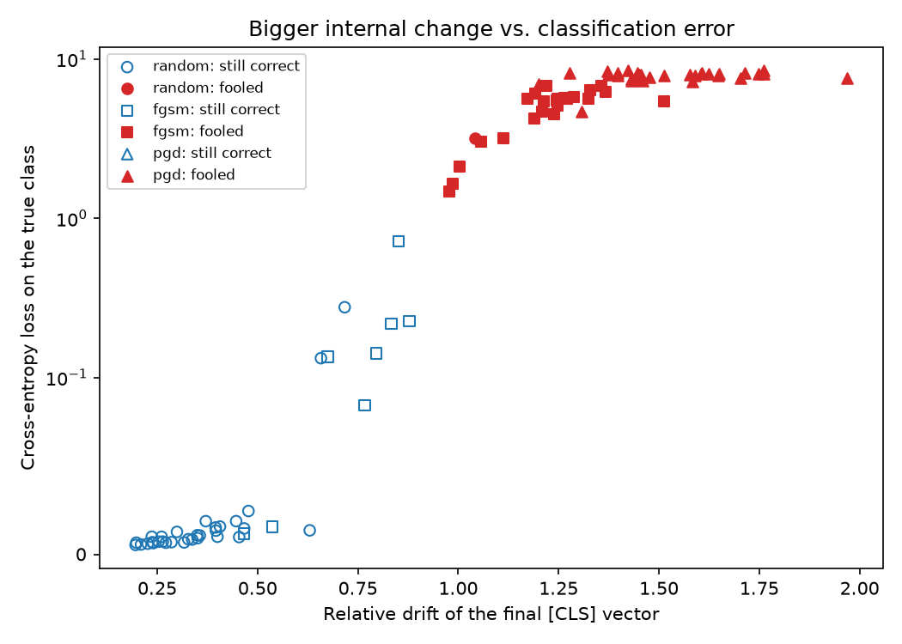

# Adversarial Attacks on a Vision Transformer (FGSM & PGD)

This small project **attacks** a ViT classifier fine-tuned on CIFAR-10. It does not retrain the model and implements no defense. It compares random noise, FGSM and PGD under the same per-pixel budget, then measures how an internal representation of the model changes.

## What the code does

1. **Objective.** For an image `x` with true class `y`, maximizing the cross-entropy `L(model(x), y)` makes the image harder to classify. Attack success is measured separately, as a change of the predicted class.
2. **FGSM.** `x_adv = clip_[0,1](x + ε · sign(∇_x L))`: a single gradient step from the original image.
3. **PGD.** Repeat `x_{t+1} = proj_[x−ε, x+ε](x_t + α · sign(∇_{x_t} L))`. The gradient is recomputed after every step; `α` is the step size and `ε` the total budget around `x`.
4. **Hook.** A `forward_hook` on the last ViT block reads the `[CLS]` vector. Its relative distance to the clean image's representation is a descriptive measure, not proof that this change causes the error.
5. **Internal change vs. error.** All attacked images (random, FGSM, PGD) are pooled: the mean `[CLS]` drift of fooled images is compared with that of images that stay correct, and the Spearman correlation between drift and loss is computed. The scatter plot is saved to `drift_vs_loss.png`.

All attacks are *white-box*: they use the target model's gradients. The model is in eval mode with frozen parameters, so gradients only flow back to the pixels. Attacks act on CIFAR-10 images **after resizing to 224×224**, but before the model's normalization, so `ε = 8/255` is expressed in that `[0,1]` pixel space.

## Running it

Requires Python 3.10+ and an environment that can install PyTorch. The first run downloads CIFAR-10 images and the weights of [`nateraw/vit-base-patch16-224-cifar10`](https://huggingface.co/nateraw/vit-base-patch16-224-cifar10), a ViT fine-tuned on this dataset.

```bash
python -m venv .venv
source .venv/bin/activate        # Windows: .venv\Scripts\Activate.ps1
python -m pip install -r requirements.txt
python test_attacks.py           # sanity checks on a toy model
python experiment.py --samples 32 --steps 10
```

On a machine without a GPU, start with `--samples 4 --steps 2` to check the pipeline; larger runs can be slow. `--data-dir` and `--out-dir` choose where downloads and results are written.

By default, `--source quick` fetches the first CIFAR-10 test images from [Hugging Face Datasets](https://huggingface.co/datasets/uoft-cs/cifar10), which avoids downloading the full 170 MB archive. Images and labels are cached in `--data-dir`, so later runs need no network. For a larger evaluation, `--source full` uses torchvision's full download. The script writes `summary.json` (success rates on initially correct images), `per_image.csv` (per-image results), `examples.png` (visual comparison) and `drift_vs_loss.png`.

## Results (32 images, ε = 8/255, PGD 10 steps of 2/255, CPU)

Command: `python experiment.py --samples 32 --steps 10`. Only images the model initially classified correctly are attacked.

| Perturbation (same ε budget) | Success rate | Mean loss | Mean relative `[CLS]` drift |
|---|---:|---:|---:|
| Random noise | 3% (1/32) | 0.12 | 0.38 |
| FGSM (1 step) | 75% (24/32) | 3.73 | 1.10 |
| PGD (10 steps) | **100%** (32/32) | 7.76 | 1.53 |

### Images before and after the attack

Each row is a test image; every column uses **the same budget** (at most 8/255 per pixel). Red means a wrong prediction. The last column shows the PGD perturbation **magnified** (grey = unchanged pixel): at normal scale it is invisible.


| True class | Random noise | FGSM | PGD |
|---|---|---|---|
| cat | cat ✓ | cat ✓ | **dog** ✗ |
| ship | ship ✓ | ship ✓ | **automobile** ✗ |
| frog | frog ✓ | frog ✓ | **dog** ✗ |
| frog | **dog** ✗ | **dog** ✗ | **dog** ✗ |
| automobile | automobile ✓ | **dog** ✗ | **dog** ✗ |
| frog | frog ✓ | **dog** ✗ | **cat** ✗ |

All 32 images are in `results/per_image.csv`. A side observation: the attacks mostly push images towards **dog** and **cat** (19 of the 32 images fooled by PGD). I have not analyzed this further; a targeted attack towards a chosen class would be a natural extension.

### What the numbers show

- **Random noise does almost nothing, FGSM fools 3 images out of 4, and PGD fools all of them**, with the same maximum change per pixel. What matters is not the size of the perturbation but its **direction**: aligned with the gradient, it is effective; random, its effects cancel out (the "n vs. √n" argument of Goodfellow et al.).
- PGD beats FGSM because it recomputes the gradient at every step: FGSM's linearization only holds locally.
- **Internal change vs. error** (96 attacked images, all methods pooled): mean drift of **1.39** when the model is fooled vs. **0.43** when it stays correct; Spearman correlation between drift and loss **0.95**.



- A caveat on that number: much of the correlation comes from pooling three methods of very different strength. The relation is also visible **within FGSM alone** on the plot, where the squares that stay correct have lower drift than the fooled ones.

## What this experiment does not show

- PGD failing with given settings would not prove that no attack exists. A serious robustness evaluation would vary the number of steps, step size and random restarts.
- The `[CLS]` distance shows an internal change, not its cause. Error rates are measured separately.
- 32 images is a small sample: the percentages are uncertain (one image is about 3 points). `--source full --samples 500` would give more reliable numbers, at the cost of a longer run on CPU.
- The perturbation is applied to the image **upscaled to 224×224**, not to the original 32×32 CIFAR image. That gives the attacker more freedom than standard CIFAR-10 benchmarks; to compare with the literature, the perturbation should be applied at 32×32 with the resizing inside the gradient computation.
- This project is about images. It does not demonstrate discrete token optimization or the robustness of a code LLM.

References: [Goodfellow et al., 2014 (FGSM)](https://arxiv.org/abs/1412.6572), [Madry et al., 2017 (PGD)](https://arxiv.org/abs/1706.06083), [ViT model card](https://huggingface.co/nateraw/vit-base-patch16-224-cifar10).
