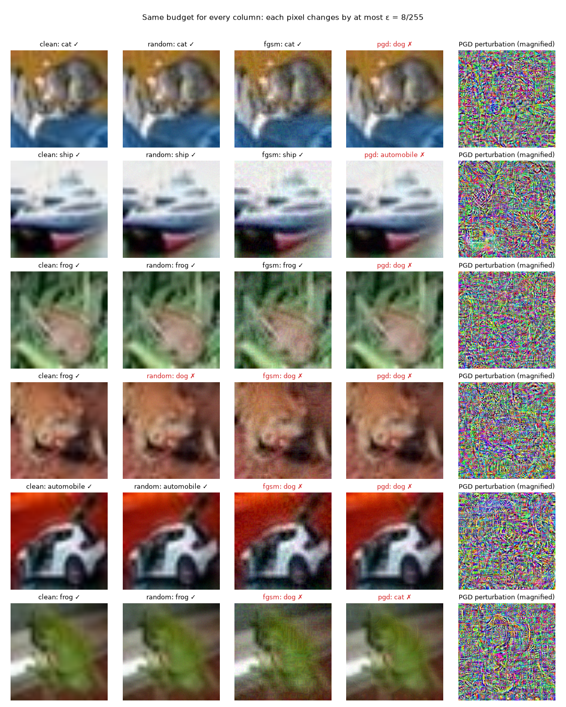

# Attaquer un Vision Transformer avec FGSM et PGD

Ce mini-projet **attaque** un classifieur ViT entraîné sur CIFAR-10. Il ne réentraîne pas le modèle et n'implémente aucune défense. Il compare des perturbations aléatoires, FGSM et PGD sous la même limite de variation par pixel, puis mesure le changement d'une représentation interne.

## Les quatre idées du code

1. **Objectif.** Pour une image `x` et sa vraie classe `y`, maximiser la cross-entropy `L(model(x), y)` augmente la difficulté de classification. La réussite est mesurée séparément par le changement de prédiction.
2. **FGSM.** `x_adv = clip_[0,1](x + ε sign(∇_x L))`. Une seule passe de gradient depuis l'image originale.
3. **PGD.** Répéter `x_{t+1} = projection_[x-ε,x+ε](x_t + α sign(∇_{x_t} L))`. Le gradient est recalculé après chaque pas ; `α` est la taille d'un pas, `ε` la limite totale depuis `x`.
4. **Hook.** Un `forward_hook` sur le dernier bloc du ViT récupère le vecteur `[CLS]`. Sa distance relative à la représentation de l'image originale est une mesure descriptive, pas une preuve que ce changement cause l'erreur.
5. **Lien changement interne ↔ erreur.** Toutes les images attaquées (aléatoire, FGSM, PGD) sont regroupées : on compare la dérive moyenne du `[CLS]` des images trompées et des images restées correctes, et on calcule la corrélation de Spearman entre dérive et loss. Le nuage de points est sauvé dans `drift_vs_loss.png`.

Toutes les attaques sont *white-box* : elles utilisent les gradients du modèle cible. Le modèle est en mode évaluation et ses paramètres sont gelés ; les gradients remontent uniquement jusqu'aux pixels. Les attaques agissent sur les images CIFAR-10 **après agrandissement à 224×224**, mais avant la normalisation du modèle. `ε=8/255` est donc exprimé dans cet espace de pixels `[0,1]`.

## Exécution

Python 3.10+ et un environnement pouvant installer PyTorch sont nécessaires. Le premier lancement télécharge CIFAR-10 et les poids du modèle [`nateraw/vit-base-patch16-224-cifar10`](https://huggingface.co/nateraw/vit-base-patch16-224-cifar10), entraîné pour ce jeu de données.

```powershell
python -m venv .venv
.venv\Scripts\Activate.ps1
python -m pip install -r requirements.txt
python experiment.py --samples 16 --steps 10
```

Sur une machine sans GPU, commencez par `--samples 4 --steps 2` pour vérifier le pipeline ; une expérience plus grande peut être lente. `--data-dir` et `--out-dir` permettent de choisir où écrire les téléchargements et résultats.

Par défaut, `--source quick` récupère les premières images du jeu de test CIFAR-10 via [Hugging Face Datasets](https://huggingface.co/datasets/uoft-cs/cifar10), ce qui évite le téléchargement intégral de 170 Mo. Les images et labels sont mis en cache dans `--data-dir` : les lancements suivants n'ont plus besoin du réseau. Pour une évaluation plus large, `--source full` utilise le téléchargement complet de `torchvision`. Le programme écrit `summary.json` (taux de réussite sur les exemples initialement corrects), `per_image.csv` (résultats individuels) et `examples.png` (comparaison visuelle). Le bruit aléatoire est borné par le même `ε` que FGSM et PGD.

## Résultats (32 images, ε = 8/255, PGD 10 pas de 2/255, CPU)

Commande : `python experiment.py --samples 32 --steps 10`. Seules les images que le modèle classait correctement au départ sont attaquées.

| Perturbation (même budget ε) | Taux de réussite | Loss moyenne | Dérive relative moyenne du `[CLS]` |
|---|---:|---:|---:|
| Bruit aléatoire | 3 % (1/32) | 0,12 | 0,38 |
| FGSM (1 pas) | 75 % (24/32) | 3,73 | 1,10 |
| PGD (10 pas) | **100 %** (32/32) | 7,76 | 1,53 |

### Les images avant et après attaque

Chaque ligne est une image du jeu de test ; chaque colonne utilise **le même budget** (au plus 8/255 par pixel). En rouge : prédiction fausse. La dernière colonne montre la perturbation PGD **amplifiée** (gris = pixel inchangé) : à l'échelle normale, elle est invisible.



| Vraie classe | Bruit aléatoire | FGSM | PGD |
|---|---|---|---|
| cat | cat ✓ | cat ✓ | **dog** ✗ |
| ship | ship ✓ | ship ✓ | **automobile** ✗ |
| frog | frog ✓ | frog ✓ | **dog** ✗ |
| frog | **dog** ✗ | **dog** ✗ | **dog** ✗ |
| automobile | automobile ✓ | **dog** ✗ | **dog** ✗ |
| frog | frog ✓ | **dog** ✗ | **cat** ✗ |

Le détail des 32 images est dans `results/per_image.csv`. Une observation au passage : les attaques poussent surtout vers **chien** et **chat** (19 des 32 images trompées par PGD). Je ne l'ai pas analysé plus loin ; ce serait une piste pour une extension (attaque ciblée vers une classe choisie).

### Ce que montrent les chiffres

- **Le bruit aléatoire ne fait presque rien, FGSM trompe 3 images sur 4 et PGD toutes**, avec la même amplitude maximale par pixel. Ce n'est donc pas la taille de la perturbation qui compte, mais sa **direction** : alignée avec le gradient, elle est efficace ; aléatoire, ses effets se compensent (l'argument « n contre √n » de Goodfellow et al.).
- PGD fait mieux que FGSM parce qu'il recalcule le gradient à chaque pas : la linéarisation de FGSM n'est valable que localement.
- **Changement interne ↔ erreur** (96 images attaquées, toutes méthodes confondues) : dérive moyenne de **1,39** quand le modèle est trompé contre **0,43** quand il reste correct ; corrélation de Spearman dérive/loss **0,95**. Voir `results/drift_vs_loss.png`.
- Attention en lisant ce chiffre : une grande partie de la corrélation vient du fait qu'on regroupe trois méthodes de force différente. Mais la relation se voit aussi **à l'intérieur de FGSM seul** sur le graphique (les carrés restés corrects ont une dérive plus faible que les carrés trompés).

## Ce que l'expérience ne prouve pas

- Un échec de PGD avec ces paramètres ne prouve pas qu'aucune attaque n'existe. Pour évaluer sérieusement la robustesse, il faudrait notamment varier le nombre de pas, la taille des pas et les départs aléatoires.
- La distance du vecteur `[CLS]` montre un changement interne, pas sa cause ni son utilité à elle seule. Le taux d'erreur est mesuré séparément.
- 32 images, c'est peu : les pourcentages ont une forte incertitude (un seul exemple représente environ 3 points). `--source full --samples 500` donnerait des chiffres plus solides, au prix d'un calcul plus long sur CPU.
- Ce projet traite des images et ne démontre pas l'optimisation discrète de tokens de texte ni la robustesse d'un LLM de code.

Références : [Goodfellow et al. (FGSM)](https://arxiv.org/abs/1412.6572), [Madry et al. (PGD)](https://arxiv.org/abs/1706.06083), [carte du modèle ViT](https://huggingface.co/nateraw/vit-base-patch16-224-cifar10).
